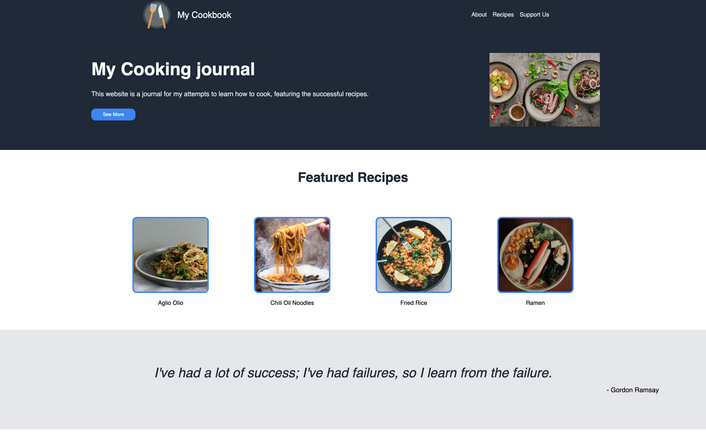
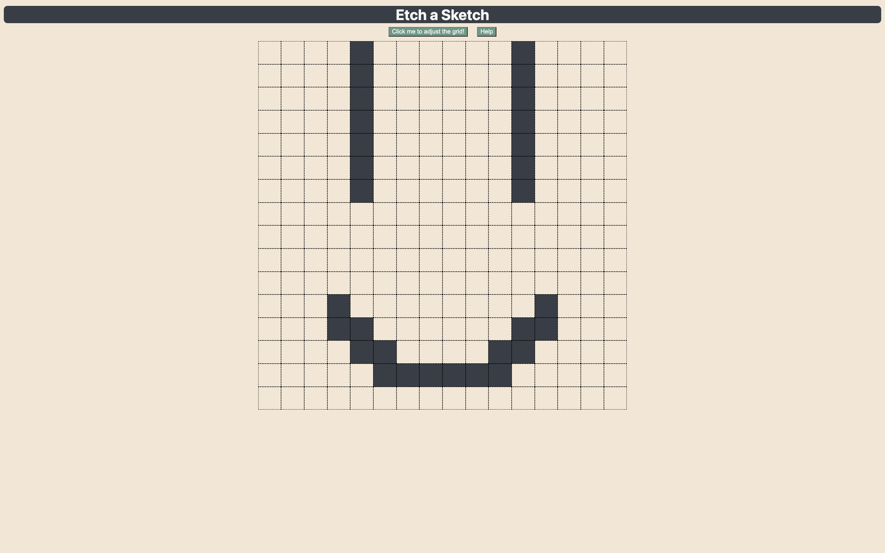
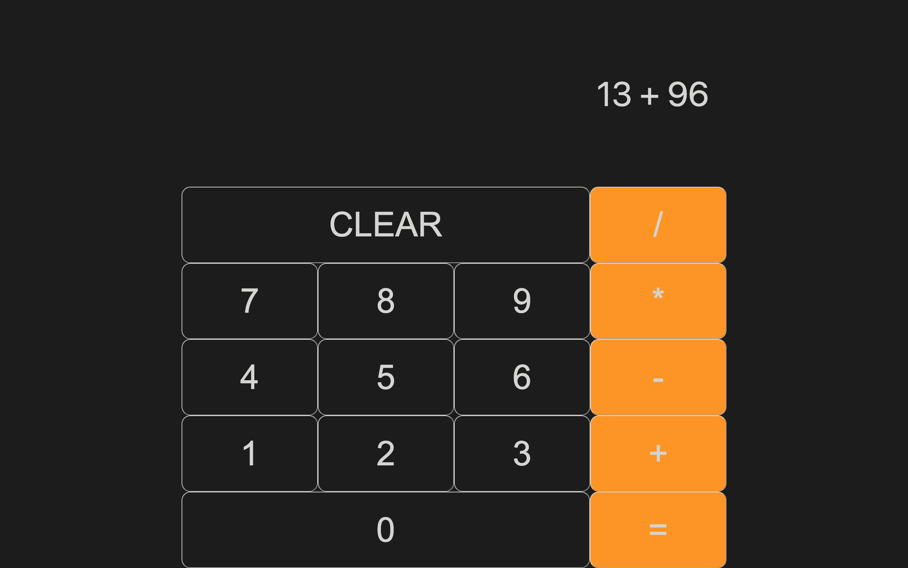

[The Odin Project](https://www.theodinproject.com/paths/foundations/courses/foundations) is a free, open-source coding curriculum that teaches web development using HTML, CSS, and JavaScript. This course equipped me with the skills to create these projects despite having no prior experience in web development.

## [Odin Landing Page](https://kailermai.github.io/odin-landing-page/)

My first webpage created purely from HTML and CSS using flexbox.

- [GitHub Repo](https://github.com/kailermai/odin-landing-page)
- Built with HTML and CSS

## [Odin Etch-a-Sketch](https://kailermai.github.io/Etch-a-Sketch/)

A browser version of something between a sketchpad and an Etch-A-Sketch. Try drawing something cute!

- [GitHub Repo](https://github.com/kailermai/Etch-a-Sketch)
- Built with HTML, CSS, and JavaScript

## [Odin Calculator](https://kailermai.github.io/odin-calculator/)

An on-screen calculator using JavaScript, HTML, and CSS.

- [GitHub Repo](https://github.com/kailermai/odin-calculator)
- Built with HTML, CSS, and JavaScript

